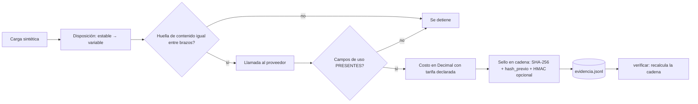

# MODEC-CE — costo y evidencia para orquestación multiagente sobre LLM

[](https://github.com/g-guarin/modec-ce/actions/workflows/pruebas.yml)


**English summary:** [README.en.md](README.en.md) · **Demo (informe interactivo / interactive report):** https://g-guarin.github.io/modec-ce/

MODEC-CE mide cuánto se ahorra en una orquestación multiagente sobre LLM al ordenar los prompts para aprovechar el caché de prefijos del proveedor. Sella cada medición en una cadena de evidencia que un tercero puede verificar.

1. **Disposición consciente del caché.** Ordena los segmentos de cada prompt de lo más estable a lo más variable: `FUNDACION → CONTEXTO → HISTORIAL → ROL → TAREA → VOLATIL`. El contenido es el mismo y se comprueba con una huella SHA-256; solo cambia el orden. Los proveedores cobran la entrada que acierta en su caché a una fracción del precio (DeepSeek: 2 %; Anthropic: 10 %; OpenAI 4.1: 25 %).
2. **Historial en Super-Tokens.** Cada salida anterior se sustituye por una referencia `artifact://sha256:…`, un resumen de hasta 350 caracteres y sus anclas `[H-nnn]`. La métrica C.1 de MODEC mide cuánto se reduce el historial y si se conservan las anclas.
3. **Evidencia sellada.** Cada medición se sella en una cadena SHA-256 con `hash_previo` y HMAC opcional. Un campo de uso que el proveedor no informa queda AUSENTE, nunca «0 aciertos», y la corrida se detiene (fallo cerrado).

Es una práctica que los proveedores recomiendan: poner primero el contenido estático. Lo que MODEC-CE añade es **medirlo** en una carga multiagente con contenido idéntico entre brazos y **dejar la medición sellada**.

## Resultados y su procedencia

<!-- CIFRAS -->
Carga sintética: 3 pasos, orquestador más 4 agentes y un corpus de 4 000 tokens. Tarifa DeepSeek `deepseek-flash` en horario normal.

| Comparación | Ahorro de costo de entrada | Procedencia |
|---|---|---|
| MODEC-CE frente a «rol arriba» (línea base fuerte) | **59,0%** | Simulación: cota superior bajo las reglas documentadas de DeepSeek |
| MODEC-CE + Super-Tokens frente a «rol arriba» | **71,4%** | Ídem; la compresión cambia el contenido |
| MODEC-CE frente a «metadatos arriba» (línea base débil) | 65,8% | Ídem |
| MODEC-CE + Super-Tokens frente a «metadatos arriba» | 76,2% | Ídem |
| Reducción de tokens del historial (C.1) | 75,6%, con 36/36 anclas conservadas | Conteo estimado; cobertura mecánica de anclas, no validez semántica |
| Sensibilidad: 2/4/8 agentes × corpus de 1k/4k/12k | 34,4 % a 76,3 % | Simulación |
| Piloto local: transformador real en CPU con caché KV | 52,7 % a 58,3 % menos latencia total por corrida (2 series de 3 corridas) | Medido en un equipo; **sin bitácora publicada, no verificable por terceros**; pesos aleatorios, sin calidad semántica |
<!-- /CIFRAS -->

Una prueba comprueba que las cifras de simulación de esta tabla coinciden con el código.

### Piloto real con DeepSeek (2026-11-21)

Carga sintética más pequeña que la de la simulación: orquestador más 3 agentes, 2 pasos y un corpus de 3 000 tokens. Hubo 3 corridas con 16 llamadas cada una (48 en total), con el orden de los brazos alternado. Todas las respuestas fueron HTTP 200 y todos los campos de uso fueron PRESENTE.

| Medida | `ingenua_rol` | `modec` |
|---|---|---|
| Tokens de entrada servidos desde caché (informado por DeepSeek) | 39,0 % | 82,5 % |
| Costo de entrada y salida de las 3 corridas (tarifa normal) | USD 0,0347 | USD 0,0121 |
| **Ahorro de MODEC-CE por corrida** | — | **65,3 % / 65,3 % / 65,3 %** |
| Latencia total de las 3 corridas | 37,1 s | 38,3 s |

- **Procedencia:** los tokens son MEDIDOS a partir del campo `usage` de DeepSeek. El costo es DERIVADO de la tarifa declarada en `datos/precios.json` y no es la factura; el titular debe conciliarlo con el panel de uso del proveedor.
- **Latencia:** sin mejora. MODEC-CE tardó un 3 % más en total (en 2 de 3 corridas fue más lento, hasta un 8 %). Con salidas de 64 tokens y llamadas por internet no se puede atribuir esa diferencia a nada; no se midió el ruido de la red. El beneficio medido es de costo, no de velocidad.
- **Evidencia:** la bitácora sellada con la cadena mínima integrada está en `evidencia/piloto_deepseek_20261121/` (50 registros: el plan, 48 llamadas y el resumen). No contiene prompts, respuestas ni claves, solo huellas, conteos, latencias y costos.
- **Verificación independiente**, sin instalar nada:
  ```bash
  python herramientas/verificar_independiente.py evidencia/piloto_deepseek_20261121
  ```
  Recalcula cada huella y cada enlace de la cadena, y recalcula el ahorro de cada corrida a partir de las llamadas.
- **Límites:** la bitácora se selló sin clave HMAC, así que se comprueba su integridad pero no su autoría. No tiene ancla externa. Falta repetir el piloto con Anthropic y OpenAI.

## Inicio rápido (sin claves ni red)

```bash
git clone https://github.com/g-guarin/modec-ce.git
cd modec-ce
python -B -m unittest discover -s tests     # pruebas (sin red)
python -B -m modec_ce simular               # 4 disposiciones
python -B -m modec_ce sensibilidad          # 2/4/8 agentes × corpus 1k/4k/12k
python -B -m modec_ce informe               # resultados/informe.html
```

Requisitos: solo Python 3.10 o superior y su biblioteca estándar. Para el piloto local con un transformador real en CPU se necesita además `torch`:

```bash
pip install torch --index-url https://download.pytorch.org/whl/cpu
python -B -m modec_ce piloto-local
```

## Pilotos con proveedores

```bash
python -B -m modec_ce piloto --proveedor deepseek                     # plan sin red: llamadas y cota de costo
python -B -m modec_ce piloto --proveedor deepseek --ejecutar --confirmar EJECUTAR-PILOTO
python -B -m modec_ce verificar resultados/<carpeta_del_piloto>
```

En Windows, `.\piloto_proveedor.ps1 -Proveedor deepseek` pide la clave de forma protegida y no la escribe en disco.

| Proveedor | Modelo por defecto | Variable de la clave | Caché |
|---|---|---|---|
| `deepseek` | `deepseek-flash` | `DEEPSEEK_API_KEY` | automático |
| `anthropic` | `claude-haiku-5-5` | `ANTHROPIC_API_KEY` | explícito (`cache_control` tras el 2.º y el 3.er segmento, igual en ambos brazos) |
| `openai` | `gpt-4.1-mini` | `OPENAI_API_KEY` | automático (prefijos de 1 024 tokens o más) |
| `openrouter` | `deepseek/deepseek-chat` | `OPENROUTER_API_KEY` | el del proveedor de destino |
| `local` | transformador en CPU | `MODEC_CE_LOCAL_KEY` (opcional) | caché KV real de prefijos |

Diseño del piloto:
- 3 corridas, cada una con su propio nonce al inicio, con el orden de los brazos alternado y las llamadas intercaladas.
- Topes de llamadas y de costo, con una cota previa que trata toda la entrada como no cacheada.
- Se detiene ante un error HTTP o un uso ausente.
- No guarda prompts, respuestas ni claves; solo huellas, conteos, latencias y costos.
- Las tarifas están en `datos/precios.json`, con su fuente y la fecha en que se leyeron.

## Motor de evidencia

| Entorno | Motor | Qué garantiza |
|---|---|---|
| Clon público (por defecto) | Cadena mínima integrada (`modec-ce-cadena-minima-v1`) | JSON ordenado + SHA-256 encadenado + HMAC opcional (`MODEC_CE_CLAVE_HEX`, 32 bytes o más). Detecta alteración, borrado intermedio y reordenación. |
| Con `pesd-nucleo` 2.0.0 instalado o en `MODEC_CE_PESD_SRC` | Núcleo PESD (propietario, opcional, no incluido) | Lo anterior, con las garantías adicionales de ese núcleo. |

Ninguno de los dos detecta, sin un ancla externa, que se haya truncado el final de la cadena; los dos lo declaran como límite. Cada resultado indica qué motor lo selló (`motor_evidencia`). `MODEC_CE_SIN_PESD=1` fuerza la cadena mínima.



## Procedencia de cada cifra

| Cifra | Procedencia |
|---|---|
| Tokens de la simulación | ESTIMADO (`aprox-regex-v1`), comparable solo entre disposiciones |
| Aciertos de la simulación | COTA SUPERIOR bajo las reglas R1–R3 de la documentación de DeepSeek |
| Piloto local | MEDIDO en un equipo |
| Piloto con proveedor | MEDIDO (campos `usage` del proveedor) |
| Costo | DERIVADO de una tarifa DECLARADA; no es la factura |

## Estructura

```text
modec_ce/        código (carga, caché, costo, evidencia, núcleo, proveedores, piloto, servidor local, simulación, informe, CLI)
datos/           precios.json (tarifas con fuente y fecha)
tests/           pruebas sin red
evidencia/       bitácoras selladas de pilotos reales publicadas a propósito
herramientas/    verificar_independiente.py (solo biblioteca estándar)
piloto_proveedor.ps1   piloto real desde PowerShell con la clave protegida
```

## Autoría

MODEC-CE es obra de Giovany Guarín Ramírez. Deriva de su metodología MODEC (Metodología de Orquestación por Dinámica de Estados Comprimidos). Aplica dos patrones de su núcleo PESD: P1, sellado en origen, y P2, presencia ternaria, en la que un dato ausente no es cero.

Los marcos conceptuales en que se apoya están descritos en dos obras registradas por el autor ante la Dirección Nacional de Derecho de Autor de Colombia:
- *Compendio Académico: Patrones Estructurales en Sistemas Digitales* (libro-tomo-partida 10-1457-377).
- *Densidad de Punto Ciego: Marco Diagnóstico y Resolución Arquitectónica en Sistemas Digitales* (libro-tomo-partida 10-1457-378).

## Licencia

Apache 2.0 (`LICENSE` y `NOTICE`). El núcleo `pesd-nucleo` es propietario, no forma parte de este repositorio y no está cubierto por esta licencia.
