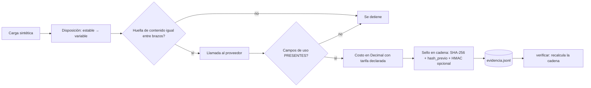

# MODEC-CE — costo y evidencia para orquestación multiagente sobre LLM

[](https://github.com/g-guarin/modec-ce/actions/workflows/pruebas.yml)


**English summary:** [README.en.md](README.en.md) · **Demo (informe HTML estático generado por el propio programa, con la simulación y los pilotos publicados):** https://g-guarin.github.io/modec-ce/ · **Cómo se ve una entrega hecha con esto:** [docs/caso-de-uso.md](docs/caso-de-uso.md)

**MODEC-CE no propone una forma nueva de abaratar el uso de modelos de lenguaje. Propone una forma de demostrar cuánto se abarató, que un tercero pueda comprobar.**

Mide el ahorro de disponer los prompts para aprovechar el caché de prefijos del proveedor en una orquestación multiagente, y sella cada medición en una cadena de evidencia verificable sin instalar nada. Cada cifra queda marcada como estimada, medida o derivada, y lo que el proveedor no informa se declara AUSENTE en lugar de contarse como cero.

Está dirigido a quien **debe sostener una cifra de costo ante alguien más** —quien la cobra, quien la compra, quien la audita, quien la publica— y no solo a quien quiere una factura menor. La razón está en [la tabla de más abajo](#qué-resuelve-esto-que-la-documentación-del-proveedor-no-resuelve): el ahorro depende tanto de la forma de la carga que un porcentaje ajeno no sirve para decidir.

**En palabras simples:** cuando dos llamadas a un modelo empiezan con exactamente el mismo texto, el proveedor reutiliza ese inicio (el *caché de prefijos*) y cobra mucho menos por él. Ponerlo primero es práctica recomendada por los propios proveedores y no es invención de este repositorio. Lo que aporta MODEC-CE es medirlo con rigor y **dejar la medición en pie para que otro la revise**.

1. **Disposición consciente del caché.** Ordena los segmentos de cada prompt de lo más estable a lo más variable: `FUNDACION → CONTEXTO → HISTORIAL → ROL → TAREA → VOLATIL`. El contenido es el mismo y se comprueba con una huella SHA-256; solo cambia el orden. Los proveedores cobran la entrada que acierta en su caché a una fracción del precio (según `datos/precios.json`, leído el 2026-11-20: DeepSeek 2 %; Anthropic 10 %, más un recargo de 1,25 veces el precio normal al escribir en el caché; OpenAI 4.1 25 %).
2. **Historial en Super-Tokens.** Cada salida anterior se sustituye por una referencia `artifact://sha256:…`, un fragmento de hasta 350 caracteres (truncado, no un resumen semántico) y la lista de sus anclas `[H-nnn]`, copiada de la salida completa. La métrica C.1 de MODEC mide cuánto se reduce el historial y si se conservan las anclas.
3. **Evidencia sellada.** Cada medición se sella en una cadena SHA-256 con `hash_previo` y HMAC opcional. Un campo de uso que el proveedor no informa queda AUSENTE, nunca «0 aciertos», y la corrida se detiene (fallo cerrado: ante la duda, se detiene en vez de suponer).

Es una práctica que los proveedores recomiendan: poner primero el contenido estático. Lo que MODEC-CE añade es **medirlo** en una carga multiagente con contenido idéntico entre brazos y **dejar la medición sellada**.

## Qué resuelve esto que la documentación del proveedor no resuelve

La técnica no es nueva ni escasa: ordenar el prompt de estable a variable es lo que los propios proveedores recomiendan, y cualquiera que lea su documentación llega a lo mismo sin este repositorio. **MODEC-CE no se propone como una forma mejor de ahorrar. Se propone como una forma de demostrar cuánto se ahorró.**

La diferencia importa porque el ahorro depende tanto de la forma de la carga que **un porcentaje ajeno no sirve para decidir**. Con el acierto de caché exactamente medido en el piloto real (39,0 % frente a 82,5 %) y sin cambiar nada más, basta alargar la salida del modelo para que el ahorro se desplome:

<!-- SALIDA -->
| Salida por llamada | Ahorro | La entrada es, de la factura |
|---|---|---|
| 64 tokens | 65,1 % | 94 % |
| 200 | 58,2 % | 84 % |
| 500 | 47,2 % | 68 % |
| 1 000 | 35,9 % | 52 % |
| 2 000 | 24,2 % | 35 % |
| 5 000 | 12,3 % | 18 % |
<!-- /SALIDA -->

La disposición del prompt abarata la entrada y no toca la salida: cuanto más escribe el modelo, menos pesa la entrada en la factura. Una prueba comprueba que esta tabla coincide con el código; se regenera con `python -m modec_ce sensibilidad`.

Por eso una afirmación como «reducimos tu gasto en IA un 65 %» es, por sí sola, casi vacía: sin la forma de la carga que la produjo no es comprobable ni comparable.

### Para quién es esto, y contra qué protege

MODEC-CE sirve a quien **tiene que sostener una cifra de costo ante alguien más**, no a quien solo quiere bajar su propia factura:

- Quien **cobra** por una optimización de costos y hoy entrega una hoja de cálculo que hizo él mismo.
- Quien **compra** esa optimización y no tiene forma de auditar la cifra que le presentan.
- Quien **publica** un resultado de costo y necesita que otro pueda reproducirlo.
- Quien **compara** proveedores o configuraciones y necesita que la comparación no dependa de su palabra.

El modelo de amenaza es ese: **quien tiene incentivo para inflar una medición de ahorro es, normalmente, quien cobra por haberla conseguido.** No hace falta mala fe para que la cifra se desvíe — basta elegir la carga favorable, la franja tarifaria favorable, o descartar la corrida que salió mal. Una bitácora encadenada no impide nada de eso por sí sola, pero sí deja constancia de **qué se midió, en qué orden, con qué tarifa y qué no se pudo medir**, de modo que la discusión deje de ser sobre la buena fe de quien presenta el número.

Contra eso protege cada pieza, y contra nada más:

| Pregunta del escéptico | Qué responde MODEC-CE |
|---|---|
| ¿Se descartaron las corridas desfavorables? | La cadena es continua y numerada: falta una y se nota |
| ¿Se retocó el resultado después? | Cada registro encadena el digest del anterior |
| ¿De dónde salen los precios? | Tabla de tarifas fechada y con su fuente, separada del código |
| ¿Cuánto es medido y cuánto supuesto? | Cada cifra se marca ESTIMADA, MEDIDA o DERIVADA |
| ¿Y lo que el proveedor no informó? | Queda AUSENTE y la corrida se detiene; nunca se cuenta como cero |
| ¿Cuándo y con qué código se produjo? | Van dentro del sello desde la versión 0.2.0 |
| ¿Hay que creerle a la herramienta? | No: el verificador corre sin instalar nada y declara sus propios límites |

Lo que **no** hace, y está dicho en [SECURITY.md](SECURITY.md): no prueba autoría sin clave, no detecta la reescritura total sin un ancla externa, y no valida que la carga medida se parezca a la suya. Para eso último la respuesta no es confiar en esta tabla, sino correr el piloto con su propia carga.

### Procedencia de los patrones

Dos comportamientos de este repositorio no son invención suya: provienen del marco de **patrones estructurales PESD** del autor, y aquí están implementados y a la vista.

- **P1, sellado encadenado.** Cada registro lleva el digest del anterior, de modo que el orden forma parte de lo sellado. Lo implementa `modec_ce/nucleo.py`; el repositorio trae una cadena mínima propia e independiente, y usa el núcleo PESD solo si está disponible.
- **P2, centinela de presencia.** Un dato que no llega no se sustituye por un valor por omisión: se marca AUSENTE y el proceso se detiene. Lo implementa `modec_ce/evidencia.py`, y gobierna tanto los campos de uso del proveedor como los campos de procedencia del propio sello, que quedan en `null` y declarados AUSENTE cuando no se pueden obtener.

Ambos se pueden leer, correr y poner a prueba en este repositorio sin tener acceso a nada más: las pruebas incluyen el caso en que P2 detiene una corrida y el caso en que una cadena reescrita sin firmas es rechazada. La mención está aquí porque describe de dónde viene el diseño, no como referencia a un componente que no se pueda inspeccionar.

## Resultados y su procedencia

<!-- CIFRAS -->
Carga sintética: 3 pasos, orquestador más 4 agentes y un corpus generado con el parámetro `tokens_corpus` = 4 000 (≈ 6 800 tokens según el estimador del proyecto). Los porcentajes de las cuatro primeras filas son de ahorro de **costo total**: entrada más 300 tokens de salida supuestos por petición. Tarifa DeepSeek `deepseek-flash` en horario normal.

| Comparación | Resultado | Procedencia |
|---|---|---|
| MODEC-CE frente a «rol arriba» (línea base fuerte) | **59,0%** | Simulación: estimación bajo las reglas R1–R3 de DeepSeek (R4 no modelada). No es una cota: en el piloto real DeepSeek acertó más que la simulación |
| MODEC-CE + Super-Tokens frente a «rol arriba» | **71,4%** | Ídem; la compresión cambia el contenido |
| MODEC-CE frente a «metadatos arriba» (línea base débil) | 65,8% | Ídem |
| MODEC-CE + Super-Tokens frente a «metadatos arriba» | 76,2% | Ídem |
| Reducción de tokens del historial (C.1) | 75,6%, con 36/36 anclas conservadas | Conteo estimado; cobertura mecánica de anclas, no validez semántica (las anclas se copian de la salida completa, así que se conservan por construcción) |
| Sensibilidad: 2/4/8 agentes × corpus de 1k/4k/12k | 34,8 % a 76,3 % con las reglas de DeepSeek (34,4 % a 76,0 % con una regla genérica de 1 024/128 tokens) | Simulación |
| Piloto local: transformador real en CPU con caché KV | 52,7 % a 58,3 % menos latencia total por corrida (2 series de 3 corridas) | Medido en un equipo; **sin bitácora publicada, no verificable por terceros**; pesos aleatorios, sin calidad semántica |
<!-- /CIFRAS -->

**Cómo leer la tabla.** «Rol arriba» (`ingenua_rol`): cada agente empieza su prompt por su rol, un patrón frecuente. «Metadatos arriba» (`ingenua_volatil`): el prompt empieza por datos de la petición que cambian cada vez. MODEC-CE (`modec`): de lo más estable a lo más variable. Cada configuración que se compara se llama *brazo*.

Una prueba comprueba que cuatro cifras de ahorro, la reducción C.1 y el conteo de anclas de esta tabla coinciden con el código. El rango de sensibilidad y las cifras de los pilotos no se comprueban automáticamente.

### Pilotos reales con DeepSeek y Anthropic (2026-11-21 y 2026-11-22)

Carga sintética más pequeña que la de la simulación: orquestador más 3 agentes, 2 pasos y un corpus generado con `tokens_corpus` = 3 000. Cada piloto son 3 corridas de 16 llamadas (48 en total), con un valor aleatorio distinto por corrida y el orden de los brazos alternado. En todos, todas las respuestas fueron HTTP 200 y todos los campos de uso fueron PRESENTE.

Hay **tres bitácoras publicadas**, de dos proveedores. El 2026-11-21 hubo además una primera ejecución sellada con otro motor de evidencia que no se publica, con resultado equivalente (65,4 % / 65,3 % / 65,4 %).

#### El efecto se replica en dos proveedores con mecanismos de caché distintos

DeepSeek cachea el prefijo por su cuenta; Anthropic solo cachea lo que el cliente marca con `cache_control`. Con el mismo reordenamiento, las tasas de acierto coinciden:

<!-- TABLA-REPLICACION -->
| Acierto de caché | `ingenua_rol` | `modec` | Ahorro de costo |
|---|---|---|---|
| **DeepSeek** `deepseek-flash` (2026-11-22) | 39,0 % | 82,5 % | 65,3 % |
| **Anthropic** `claude-haiku-5-5` (2026-11-22) | 38,9 % | 84,0 % | 60,1 % |
<!-- /TABLA-REPLICACION -->

La diferencia entre las tasas de los dos proveedores es de punto y medio, lo que sitúa el efecto en **la estructura del prompt** y no en el mecanismo de caché de un proveedor concreto. El ahorro de costo sí difiere (65,3 % frente a 60,1 %) porque las tarifas son distintas: Anthropic cobra la escritura en caché a 1,25 veces el precio de entrada, y DeepSeek no.

Alcance de la replicación: dos proveedores, **una sola carga sintética**. Replicado entre proveedores no es replicado entre cargas.

#### Detalle de cada piloto

| Medida | `ingenua_rol` | `modec` |
|---|---|---|
| Tokens de entrada servidos desde caché (informado por DeepSeek) | 39,0 % | 82,5 % |
| Costo de entrada y salida de las 3 corridas (tarifa pico) | USD 0,0347 | USD 0,0120 |
| **Ahorro de MODEC-CE por corrida** | — | **65,3 % / 65,4 % / 65,3 %** |

*DeepSeek `deepseek-flash`, 2026-11-22, versión 0.2.0. DeepSeek facturó entre 5 842 y 8 939 tokens de entrada por llamada.*

| Medida | `ingenua_rol` | `modec` |
|---|---|---|
| Tokens de entrada servidos desde caché (informado por Anthropic) | 38,9 % | 84,0 % |
| Costo de entrada y salida de las 3 corridas (tarifa `standard`) | USD 0,0217 | USD 0,0087 |
| **Ahorro de MODEC-CE por corrida** | — | **60,1 % / 60,1 % / 60,1 %** |

*Anthropic `claude-haiku-5-5`, 2026-11-22, commit `62b8c05` con el árbol limpio. Entre 9 154 y 14 173 tokens de entrada por llamada. Los puntos de caché (`cache_control`) se colocan en las mismas posiciones en ambos brazos: lo que cambia es qué contenido queda antes de ellos.*

**Reproducibilidad.** El piloto del 2026-11-21 (versión 0.1.0, otro código y otros valores aleatorios) dio 39,0 % y 82,5 % de acierto de caché, USD 0,0347 y USD 0,0121 de costo, y 65,3 % de ahorro en las tres corridas. Las dos ejecuciones coinciden hasta la cuarta cifra significativa en el costo del brazo base. No es un número que salió una vez.

- **Procedencia:** los tokens son MEDIDOS a partir del campo `usage` de DeepSeek. El costo es DERIVADO de la tarifa declarada en `datos/precios.json` y no es la factura; conviene contrastarlo con el panel de uso del proveedor.
- **Latencia: no hay efecto medible.** El total por corrida está dominado por la llamada más lenta, no por el método. Dos corridas del mismo piloto, con media hora de diferencia:

  | Corrida | «Reducción de latencia» calculada sobre totales | Medianas de las 16 llamadas |
  |---|---|---|
  | Anthropic 21:13, corrida 1 | **+83,1 %** a favor de `modec` | 1 754 ms frente a 1 609 ms (+8 %) |
  | Anthropic 22:09, corrida 2 | **−99,2 %** en contra de `modec` | 1 584 ms frente a 1 629 ms (−3 %) |

  En la primera, una llamada del brazo base se colgó unos 63 segundos; en la segunda, una del brazo `modec`. Las medianas se mantuvieron entre 1 555 y 1 754 ms en los dos brazos de las seis corridas: de −2,8 % a +5,2 %.

  El informe publica la latencia como rango y dispersión, no como resultado. **El beneficio medido es de costo, no de velocidad**, y tampoco hay evidencia de que cueste velocidad.
- **Evidencia:** las tres bitácoras selladas con la cadena mínima integrada están en `evidencia/piloto_deepseek_20261121/`, `evidencia/piloto_deepseek_20261122_135846_5c1d7c/` y `evidencia/piloto_anthropic_20261122_220948_bb1b11/` (50 registros cada una: el plan, 48 llamadas y el resumen). No contienen prompts, respuestas ni claves, solo huellas, conteos, latencias y costos. Se publican con el nombre de carpeta que produjo el programa, sin renombrar.
- **Verificación independiente**, sin instalar nada:
  ```bash
  python herramientas/verificar_independiente.py evidencia/piloto_deepseek_20261122_135846_5c1d7c
  # con clave, para comprobar también autoría (modo estricto):
  python herramientas/verificar_independiente.py evidencia/<carpeta> --hmac-hex <clave_hex>
  ```
  Recalcula el digest SHA-256 de cada registro, cada enlace `hash_previo` y el ahorro de cada corrida a partir de los costos registrados en las llamadas. No recalcula el costo a partir de tokens y tarifa.
- **Ancla temporal.** Dos de las tres bitácoras tienen un **sello de tiempo RFC 3161** sobre el digest de su último registro, emitido por FreeTSA, en [`sello/`](sello/):

  | Bitácora | Instante acreditado |
  |---|---|
  | `piloto_deepseek_20261122_135846_5c1d7c` | 22 de noviembre de 2026, 22:17:24 GMT |
  | `piloto_anthropic_20261122_220948_bb1b11` | 23 de noviembre de 2026, 03:22:02 GMT |

  Acredita, ante quien no tenga por qué creerle al autor, que esa cadena existía a más tardar en ese instante. Con ella, reescribir la bitácora entera deja de ser indetectable. Junto a cada sello se publican los certificados de la autoridad, porque si dejara de estar disponible harían falta para comprobarlo. Ambos sellos se verificaron en dos equipos distintos, con sistemas operativos y versiones de OpenSSL distintas. Para verificarlo:
  ```bash
  cd sello/piloto_anthropic_20261122_220948_bb1b11
  openssl ts -verify -in ancla.tsr -queryfile ancla.tsq -CAfile cacert.pem -untrusted tsa.crt
  ```
  `verificar_independiente.py` comprueba por su cuenta que el ancla **contiene el digest final de esa cadena** —es decir, que es su ancla y no la de otra— pero **no comprueba la firma** de la autoridad, porque eso exige leer ASN.1 y la herramienta no tiene dependencias. Lo declara en su salida en vez de darlo por hecho.
- **Límites:** las tres bitácoras se sellaron sin clave HMAC, así que se comprueba su integridad pero no su autoría. No son equivalentes entre sí, y el verificador declara la diferencia en su salida:

  | Bitácora | Ancla | Fecha y commit dentro del sello | Árbol limpio |
  |---|---|---|---|
  | `piloto_deepseek_20261121` | no | no — la fecha solo está en el nombre de la carpeta | no declarado |
  | `piloto_deepseek_20261122_135846_5c1d7c` | sí | sí | sí |
  | `piloto_anthropic_20261122_220948_bb1b11` | sí | sí (`62b8c05`, publicado) | sí |

  Sobre la primera, el verificador añade `SIN ANCLA EXTERNA`, `SIN FECHA EN EL SELLO` y `SIN COMMIT EN EL SELLO`; sobre las otras dos, ninguno de los tres. La fecha sellada dentro del payload sigue siendo la **declarada** por el equipo que ejecutó: lo que la respalda ante un tercero es el ancla, no ella misma.

  Los adaptadores de OpenAI y OpenRouter siguen probados solo con respuestas simuladas, no con llamadas reales; falta repetir el piloto con OpenAI.

## Inicio rápido (sin claves ni red)

```bash
git clone https://github.com/g-guarin/modec-ce.git
cd modec-ce
python -B -m unittest discover -s tests     # pruebas (sin red)
python -B -m modec_ce simular               # 4 variantes
python -B -m modec_ce sensibilidad          # 2/4/8 agentes × corpus 1k/4k/12k
python -B -m modec_ce informe               # resultados/informe.html
```

Requisitos: solo Python 3.10 o superior y su biblioteca estándar. Para el piloto local con un transformador real en CPU se necesita además `torch`:

```bash
pip install torch --index-url https://download.pytorch.org/whl/cpu
python -B -m modec_ce piloto-local
```

## Pilotos con proveedores

```bash
python -B -m modec_ce piloto --proveedor deepseek                     # plan sin red: llamadas y cota de costo
python -B -m modec_ce piloto --proveedor deepseek --ejecutar --confirmar EJECUTAR-PILOTO
python -B -m modec_ce verificar resultados/<carpeta_del_piloto>
```

En Windows, `.\piloto_proveedor.ps1 -Proveedor deepseek` pide la clave de forma protegida y no la escribe en disco. Con OpenAI el plan por defecto no cabe en el tope de USD 0,50 (cota USD 0,56): use `--presupuesto 0.60`, o `-Presupuesto 0.60` en el script.

| Proveedor | Modelo por defecto | Variable de la clave | Caché |
|---|---|---|---|
| `deepseek` | `deepseek-flash` | `DEEPSEEK_API_KEY` | automático |
| `anthropic` | `claude-haiku-5-5` | `ANTHROPIC_API_KEY` | explícito (`cache_control` tras el 2.º y el 3.er segmento, igual en ambos brazos) |
| `openai` | `gpt-4.1-mini` | `OPENAI_API_KEY` | automático (prefijos de 1 024 tokens o más) |
| `openrouter` | `deepseek/deepseek-chat` | `OPENROUTER_API_KEY` | el del proveedor de destino |
| `local` (solo con `piloto-local`) | transformador en CPU | `MODEC_CE_LOCAL_KEY` (opcional) | caché KV real de prefijos |

Diseño del piloto:
- 3 corridas, cada una con su propio valor aleatorio al inicio (para que el caché de una corrida no ayude a la siguiente), con el orden de los brazos alternado y las llamadas intercaladas.
- Topes de llamadas y de costo, con una cota previa que trata toda la entrada como no cacheada.
- Se detiene ante un error HTTP, un uso ausente o contenido distinto entre brazos. No sigue redirecciones.
- Excepción documentada a «ausente no es cero»: en OpenAI y OpenRouter, si la respuesta no trae `cache_write_tokens`, se toma como 0 (ese campo no entra en la clasificación de presencia). El resto de los campos de uso sí fallan cerrado.
- No guarda prompts, respuestas ni claves; solo huellas, conteos, latencias, costos y, si hay un fallo, el mensaje de error del proveedor (hasta 300 caracteres).
- Las tarifas están en `datos/precios.json`, con su fuente y la fecha en que se leyeron.

## Motor de evidencia

| Entorno | Motor | Qué garantiza |
|---|---|---|
| Clon público (por defecto) | Cadena mínima integrada (`modec-ce-cadena-minima-v1`) | JSON ordenado + SHA-256 encadenado + HMAC opcional (`MODEC_CE_CLAVE_HEX`, 32 bytes o más). Detecta alteración, borrado intermedio y reordenación. |
| Con `pesd-nucleo` 2.0.0 instalado o en `MODEC_CE_PESD_SRC` | Núcleo PESD (propietario, opcional, no incluido) | Según el autor, lo anterior más garantías adicionales de ese núcleo. Una bitácora sellada con él no se puede verificar sin él. |

Ninguno de los dos detecta, sin un ancla externa, que se haya truncado el final de la cadena ni que se haya reescrito entera (sin clave HMAC); los dos lo declaran como límite. Cada resultado indica qué motor lo selló (`motor_evidencia`). `MODEC_CE_SIN_PESD=1` fuerza la cadena mínima.

Qué ata el sello y qué no:

| Pregunta del tercero | ¿La responde el sello? |
|---|---|
| ¿Se alteró, borró o reordenó algún registro? | Sí |
| ¿Quién lo selló? | Solo con clave HMAC, y en modo estricto (se exige firma en todos los registros) |
| ¿Cuándo se produjo? | Desde 0.2.0 va dentro del payload, pero es una fecha **declarada** por el equipo que ejecuta |
| ¿Con qué versión del código? | Desde 0.2.0: versión, commit y si el árbol estaba limpio |
| ¿Se truncó el final o se reescribió todo? | No, sin ancla externa (sello de tiempo RFC 3161 sobre el último `digest`) |



## Procedencia de cada cifra

| Cifra | Procedencia |
|---|---|
| Tokens de la simulación | ESTIMADO (`aprox-regex-v1`), comparable solo entre disposiciones |
| Aciertos de la simulación | ESTIMADO bajo las reglas R1–R3 de la documentación de DeepSeek (R4 no modelada); no es una cota |
| Piloto local | MEDIDO en un equipo |
| Piloto con proveedor | MEDIDO (campos `usage` del proveedor) |
| Costo | DERIVADO de una tarifa DECLARADA; no es la factura |

## Estructura

```text
modec_ce/        código (carga, caché, costo, evidencia, núcleo, proveedores, piloto, servidor local, simulación, tokens, informe, CLI)
datos/           precios.json (tarifas con fuente y fecha)
tests/           pruebas sin red
evidencia/       bitácoras selladas de pilotos reales publicadas a propósito
herramientas/    verificar_independiente.py (solo biblioteca estándar)
piloto_proveedor.ps1   piloto real desde PowerShell con la clave protegida
sellar_tiempo.ps1      ancla temporal RFC 3161 sobre el digest final de una bitácora
sello/                 anclas temporales: solicitud, respuesta firmada, certificados y registro
```

## Autoría

MODEC-CE es obra de Giovany Guarín Ramírez. Deriva de su metodología MODEC (Metodología de Orquestación por Dinámica de Estados Comprimidos). Aplica dos patrones de su núcleo PESD: P1, sellado en origen, y P2, presencia ternaria, en la que un dato ausente no es cero.

Los marcos conceptuales en que se apoya están descritos en dos obras registradas por el autor ante la Dirección Nacional de Derecho de Autor de Colombia:
- *Compendio Académico: Patrones Estructurales en Sistemas Digitales* (libro-tomo-partida 10-1457-377).
- *Densidad de Punto Ciego: Marco Diagnóstico y Resolución Arquitectónica en Sistemas Digitales* (libro-tomo-partida 10-1457-378).

## Licencia

Apache 2.0 (`LICENSE` y `NOTICE`). El núcleo `pesd-nucleo` es propietario, no forma parte de este repositorio y no está cubierto por esta licencia.
