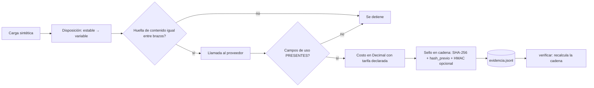

# MODEC-CE — costo y evidencia para orquestación multiagente sobre LLM

[](https://github.com/g-guarin/modec-ce/actions/workflows/pruebas.yml)


**English summary:** [README.en.md](README.en.md) · **Demo (informe HTML estático generado por el propio programa, con la simulación y los pilotos publicados):** https://g-guarin.github.io/modec-ce/

MODEC-CE mide cuánto se ahorra en una orquestación multiagente sobre LLM al ordenar los prompts para aprovechar el caché de prefijos del proveedor. Sella cada medición en una cadena de evidencia que un tercero puede verificar sin instalar nada, siempre que esté sellada con la cadena mínima integrada en este repositorio.

**En palabras simples:** cuando dos llamadas a un modelo empiezan con exactamente el mismo texto, el proveedor reutiliza ese inicio (el *caché de prefijos*) y cobra mucho menos por él. MODEC-CE ordena el prompt para que lo que más se repite quede primero y mide cuánto se ahorra de verdad.

1. **Disposición consciente del caché.** Ordena los segmentos de cada prompt de lo más estable a lo más variable: `FUNDACION → CONTEXTO → HISTORIAL → ROL → TAREA → VOLATIL`. El contenido es el mismo y se comprueba con una huella SHA-256; solo cambia el orden. Los proveedores cobran la entrada que acierta en su caché a una fracción del precio (según `datos/precios.json`, leído el 2026-11-20: DeepSeek 2 %; Anthropic 10 %, más un recargo de 1,25 veces el precio normal al escribir en el caché; OpenAI 4.1 25 %).
2. **Historial en Super-Tokens.** Cada salida anterior se sustituye por una referencia `artifact://sha256:…`, un fragmento de hasta 350 caracteres (truncado, no un resumen semántico) y la lista de sus anclas `[H-nnn]`, copiada de la salida completa. La métrica C.1 de MODEC mide cuánto se reduce el historial y si se conservan las anclas.
3. **Evidencia sellada.** Cada medición se sella en una cadena SHA-256 con `hash_previo` y HMAC opcional. Un campo de uso que el proveedor no informa queda AUSENTE, nunca «0 aciertos», y la corrida se detiene (fallo cerrado: ante la duda, se detiene en vez de suponer).

Es una práctica que los proveedores recomiendan: poner primero el contenido estático. Lo que MODEC-CE añade es **medirlo** en una carga multiagente con contenido idéntico entre brazos y **dejar la medición sellada**.

## Resultados y su procedencia

<!-- CIFRAS -->
Carga sintética: 3 pasos, orquestador más 4 agentes y un corpus generado con el parámetro `tokens_corpus` = 4 000 (≈ 6 800 tokens según el estimador del proyecto). Los porcentajes de las cuatro primeras filas son de ahorro de **costo total**: entrada más 300 tokens de salida supuestos por petición. Tarifa DeepSeek `deepseek-flash` en horario normal.

| Comparación | Resultado | Procedencia |
|---|---|---|
| MODEC-CE frente a «rol arriba» (línea base fuerte) | **59,0%** | Simulación: estimación bajo las reglas R1–R3 de DeepSeek (R4 no modelada). No es una cota: en el piloto real DeepSeek acertó más que la simulación |
| MODEC-CE + Super-Tokens frente a «rol arriba» | **71,4%** | Ídem; la compresión cambia el contenido |
| MODEC-CE frente a «metadatos arriba» (línea base débil) | 65,8% | Ídem |
| MODEC-CE + Super-Tokens frente a «metadatos arriba» | 76,2% | Ídem |
| Reducción de tokens del historial (C.1) | 75,6%, con 36/36 anclas conservadas | Conteo estimado; cobertura mecánica de anclas, no validez semántica (las anclas se copian de la salida completa, así que se conservan por construcción) |
| Sensibilidad: 2/4/8 agentes × corpus de 1k/4k/12k | 34,8 % a 76,3 % con las reglas de DeepSeek (34,4 % a 76,0 % con una regla genérica de 1 024/128 tokens) | Simulación |
| Piloto local: transformador real en CPU con caché KV | 52,7 % a 58,3 % menos latencia total por corrida (2 series de 3 corridas) | Medido en un equipo; **sin bitácora publicada, no verificable por terceros**; pesos aleatorios, sin calidad semántica |
<!-- /CIFRAS -->

**Cómo leer la tabla.** «Rol arriba» (`ingenua_rol`): cada agente empieza su prompt por su rol, un patrón frecuente. «Metadatos arriba» (`ingenua_volatil`): el prompt empieza por datos de la petición que cambian cada vez. MODEC-CE (`modec`): de lo más estable a lo más variable. Cada configuración que se compara se llama *brazo*.

Una prueba comprueba que cuatro cifras de ahorro, la reducción C.1 y el conteo de anclas de esta tabla coinciden con el código. El rango de sensibilidad y las cifras de los pilotos no se comprueban automáticamente.

### Pilotos reales con DeepSeek (2026-11-21 y 2026-11-22)

Carga sintética más pequeña que la de la simulación: orquestador más 3 agentes, 2 pasos y un corpus generado con `tokens_corpus` = 3 000 (≈ 5 100 tokens según el estimador del proyecto; DeepSeek facturó entre 5 842 y 8 939 tokens de entrada por llamada). Cada piloto son 3 corridas de 16 llamadas (48 en total), con un valor aleatorio distinto por corrida y el orden de los brazos alternado. En ambos, todas las respuestas fueron HTTP 200 y todos los campos de uso fueron PRESENTE.

Hay **dos bitácoras publicadas**, de días y versiones distintas. El 2026-11-21 hubo además una primera ejecución sellada con otro motor de evidencia que no se publica, con resultado equivalente (65,4 % / 65,3 % / 65,4 %).

| Medida | `ingenua_rol` | `modec` |
|---|---|---|
| Tokens de entrada servidos desde caché (informado por DeepSeek) | 39,0 % | 82,5 % |
| Costo de entrada y salida de las 3 corridas (tarifa pico) | USD 0,0347 | USD 0,0120 |
| **Ahorro de MODEC-CE por corrida** | — | **65,3 % / 65,4 % / 65,3 %** |
| Latencia total de las 3 corridas | 41,7 s | 41,9 s |

*Cifras del piloto del 2026-11-22 (versión 0.2.0).*

**Reproducibilidad.** El piloto del 2026-11-21 (versión 0.1.0, otro código y otros valores aleatorios) dio 39,0 % y 82,5 % de acierto de caché, USD 0,0347 y USD 0,0121 de costo, y 65,3 % de ahorro en las tres corridas. Las dos ejecuciones coinciden hasta la cuarta cifra significativa en el costo del brazo base. No es un número que salió una vez.

- **Procedencia:** los tokens son MEDIDOS a partir del campo `usage` de DeepSeek. El costo es DERIVADO de la tarifa declarada en `datos/precios.json` y no es la factura; conviene contrastarlo con el panel de uso del proveedor.
- **Latencia: no hay efecto medible, en ningún sentido.** Sobre las 6 corridas de los dos pilotos, MODEC-CE fue más rápido en 3 y más lento en 3 (de −7,7 % a +3,1 % por corrida), y en total quedó un 3 % más lento el primer día y un 0,5 % el segundo. Con salidas de 64 tokens y llamadas por internet, esa dispersión es ruido de red: no se midió por separado, así que no se atribuye a la disposición del prompt. **El beneficio medido es de costo, no de velocidad**, y tampoco hay evidencia de que cueste velocidad.
- **Evidencia:** las bitácoras selladas con la cadena mínima integrada están en `evidencia/piloto_deepseek_20261121/` y `evidencia/piloto_deepseek_20261122_135846_5c1d7c/` (50 registros cada una: el plan, 48 llamadas y el resumen). No contienen prompts, respuestas ni claves, solo huellas, conteos, latencias y costos. Se publican con el nombre de carpeta que produjo el programa, sin renombrar.
- **Verificación independiente**, sin instalar nada:
  ```bash
  python herramientas/verificar_independiente.py evidencia/piloto_deepseek_20261122_135846_5c1d7c
  # con clave, para comprobar también autoría (modo estricto):
  python herramientas/verificar_independiente.py evidencia/<carpeta> --hmac-hex <clave_hex>
  ```
  Recalcula el digest SHA-256 de cada registro, cada enlace `hash_previo` y el ahorro de cada corrida a partir de los costos registrados en las llamadas. No recalcula el costo a partir de tokens y tarifa.
- **Límites:** las dos bitácoras se sellaron sin clave HMAC, así que se comprueba su integridad pero no su autoría, y ninguna tiene ancla externa. Se diferencian en un punto: **la del 2026-11-21, producida con 0.1.0, no declara dentro del sello ni la fecha ni la versión del código** —la fecha solo aparece en el nombre de su carpeta, fuera de la cadena— mientras que la del 2026-11-22 sella `fecha_utc`, `version_modec_ce`, `commit` y `arbol_limpio`. El verificador declara esa diferencia por sí mismo: sobre la primera añade los límites `SIN FECHA EN EL SELLO` y `SIN COMMIT EN EL SELLO`, y sobre la segunda no. La fecha sellada sigue siendo la **declarada** por el equipo que ejecutó; convertirla en fecha verificable por un tercero requiere un sello de tiempo RFC 3161 sobre el digest del último registro, que todavía no se ha aplicado. Los adaptadores de Anthropic, OpenAI y OpenRouter solo se han probado con respuestas simuladas, no con llamadas reales; falta repetir el piloto con Anthropic y OpenAI.

## Inicio rápido (sin claves ni red)

```bash
git clone https://github.com/g-guarin/modec-ce.git
cd modec-ce
python -B -m unittest discover -s tests     # pruebas (sin red)
python -B -m modec_ce simular               # 4 variantes
python -B -m modec_ce sensibilidad          # 2/4/8 agentes × corpus 1k/4k/12k
python -B -m modec_ce informe               # resultados/informe.html
```

Requisitos: solo Python 3.10 o superior y su biblioteca estándar. Para el piloto local con un transformador real en CPU se necesita además `torch`:

```bash
pip install torch --index-url https://download.pytorch.org/whl/cpu
python -B -m modec_ce piloto-local
```

## Pilotos con proveedores

```bash
python -B -m modec_ce piloto --proveedor deepseek                     # plan sin red: llamadas y cota de costo
python -B -m modec_ce piloto --proveedor deepseek --ejecutar --confirmar EJECUTAR-PILOTO
python -B -m modec_ce verificar resultados/<carpeta_del_piloto>
```

En Windows, `.\piloto_proveedor.ps1 -Proveedor deepseek` pide la clave de forma protegida y no la escribe en disco. Con OpenAI el plan por defecto no cabe en el tope de USD 0,50 (cota USD 0,56): use `--presupuesto 0.60`, o `-Presupuesto 0.60` en el script.

| Proveedor | Modelo por defecto | Variable de la clave | Caché |
|---|---|---|---|
| `deepseek` | `deepseek-flash` | `DEEPSEEK_API_KEY` | automático |
| `anthropic` | `claude-haiku-5-5` | `ANTHROPIC_API_KEY` | explícito (`cache_control` tras el 2.º y el 3.er segmento, igual en ambos brazos) |
| `openai` | `gpt-4.1-mini` | `OPENAI_API_KEY` | automático (prefijos de 1 024 tokens o más) |
| `openrouter` | `deepseek/deepseek-chat` | `OPENROUTER_API_KEY` | el del proveedor de destino |
| `local` (solo con `piloto-local`) | transformador en CPU | `MODEC_CE_LOCAL_KEY` (opcional) | caché KV real de prefijos |

Diseño del piloto:
- 3 corridas, cada una con su propio valor aleatorio al inicio (para que el caché de una corrida no ayude a la siguiente), con el orden de los brazos alternado y las llamadas intercaladas.
- Topes de llamadas y de costo, con una cota previa que trata toda la entrada como no cacheada.
- Se detiene ante un error HTTP, un uso ausente o contenido distinto entre brazos. No sigue redirecciones.
- Excepción documentada a «ausente no es cero»: en OpenAI y OpenRouter, si la respuesta no trae `cache_write_tokens`, se toma como 0 (ese campo no entra en la clasificación de presencia). El resto de los campos de uso sí fallan cerrado.
- No guarda prompts, respuestas ni claves; solo huellas, conteos, latencias, costos y, si hay un fallo, el mensaje de error del proveedor (hasta 300 caracteres).
- Las tarifas están en `datos/precios.json`, con su fuente y la fecha en que se leyeron.

## Motor de evidencia

| Entorno | Motor | Qué garantiza |
|---|---|---|
| Clon público (por defecto) | Cadena mínima integrada (`modec-ce-cadena-minima-v1`) | JSON ordenado + SHA-256 encadenado + HMAC opcional (`MODEC_CE_CLAVE_HEX`, 32 bytes o más). Detecta alteración, borrado intermedio y reordenación. |
| Con `pesd-nucleo` 2.0.0 instalado o en `MODEC_CE_PESD_SRC` | Núcleo PESD (propietario, opcional, no incluido) | Según el autor, lo anterior más garantías adicionales de ese núcleo. Una bitácora sellada con él no se puede verificar sin él. |

Ninguno de los dos detecta, sin un ancla externa, que se haya truncado el final de la cadena ni que se haya reescrito entera (sin clave HMAC); los dos lo declaran como límite. Cada resultado indica qué motor lo selló (`motor_evidencia`). `MODEC_CE_SIN_PESD=1` fuerza la cadena mínima.

Qué ata el sello y qué no:

| Pregunta del tercero | ¿La responde el sello? |
|---|---|
| ¿Se alteró, borró o reordenó algún registro? | Sí |
| ¿Quién lo selló? | Solo con clave HMAC, y en modo estricto (se exige firma en todos los registros) |
| ¿Cuándo se produjo? | Desde 0.2.0 va dentro del payload, pero es una fecha **declarada** por el equipo que ejecuta |
| ¿Con qué versión del código? | Desde 0.2.0: versión, commit y si el árbol estaba limpio |
| ¿Se truncó el final o se reescribió todo? | No, sin ancla externa (sello de tiempo RFC 3161 sobre el último `digest`) |



## Procedencia de cada cifra

| Cifra | Procedencia |
|---|---|
| Tokens de la simulación | ESTIMADO (`aprox-regex-v1`), comparable solo entre disposiciones |
| Aciertos de la simulación | ESTIMADO bajo las reglas R1–R3 de la documentación de DeepSeek (R4 no modelada); no es una cota |
| Piloto local | MEDIDO en un equipo |
| Piloto con proveedor | MEDIDO (campos `usage` del proveedor) |
| Costo | DERIVADO de una tarifa DECLARADA; no es la factura |

## Estructura

```text
modec_ce/        código (carga, caché, costo, evidencia, núcleo, proveedores, piloto, servidor local, simulación, tokens, informe, CLI)
datos/           precios.json (tarifas con fuente y fecha)
tests/           pruebas sin red
evidencia/       bitácoras selladas de pilotos reales publicadas a propósito
herramientas/    verificar_independiente.py (solo biblioteca estándar)
piloto_proveedor.ps1   piloto real desde PowerShell con la clave protegida
```

## Autoría

MODEC-CE es obra de Giovany Guarín Ramírez. Deriva de su metodología MODEC (Metodología de Orquestación por Dinámica de Estados Comprimidos). Aplica dos patrones de su núcleo PESD: P1, sellado en origen, y P2, presencia ternaria, en la que un dato ausente no es cero.

Los marcos conceptuales en que se apoya están descritos en dos obras registradas por el autor ante la Dirección Nacional de Derecho de Autor de Colombia:
- *Compendio Académico: Patrones Estructurales en Sistemas Digitales* (libro-tomo-partida 10-1457-377).
- *Densidad de Punto Ciego: Marco Diagnóstico y Resolución Arquitectónica en Sistemas Digitales* (libro-tomo-partida 10-1457-378).

## Licencia

Apache 2.0 (`LICENSE` y `NOTICE`). El núcleo `pesd-nucleo` es propietario, no forma parte de este repositorio y no está cubierto por esta licencia.
